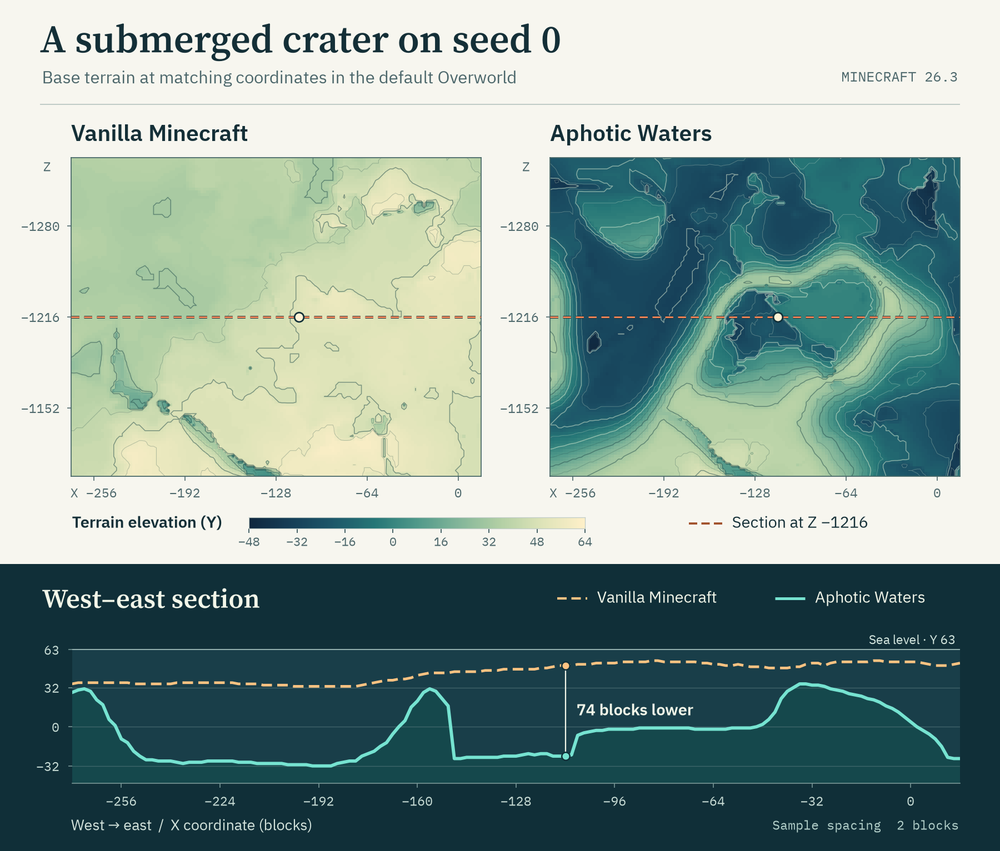

# aphotic waters

mod for block game to make virtual water feel like real water.

check [TODO.md](TODO.md) for list of features.

## ocean terrain

at the marked point (X −112, Z −1216), the seafloor sits at Y 50 in vanilla and Y −24 with Aphotic Waters, a 74-block drop. both maps sample base terrain every two blocks, before structures and decoration.

## development

> the included Gradle wrapper downloads the build tools and game dependencies on the first build. JDK 25 is required (I think).

run `make help` to list targets. if needed, pass Gradle options with `GRADLE_ARGS`, like: `make build GRADLE_ARGS=--info`.

for a dedicated server:

1. run `make server`
2. review the EULA in `run/server/eula.txt`
3. set `eula=true`
4. run `make server` again.
